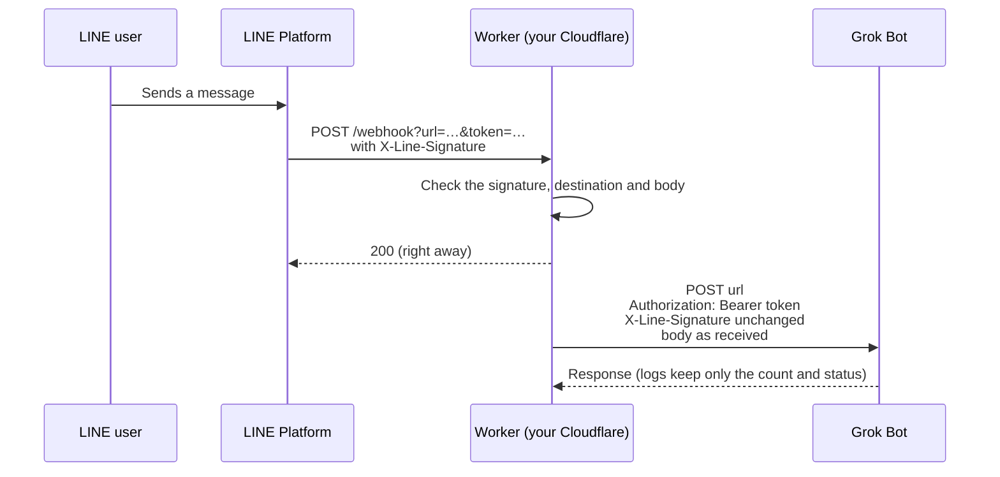
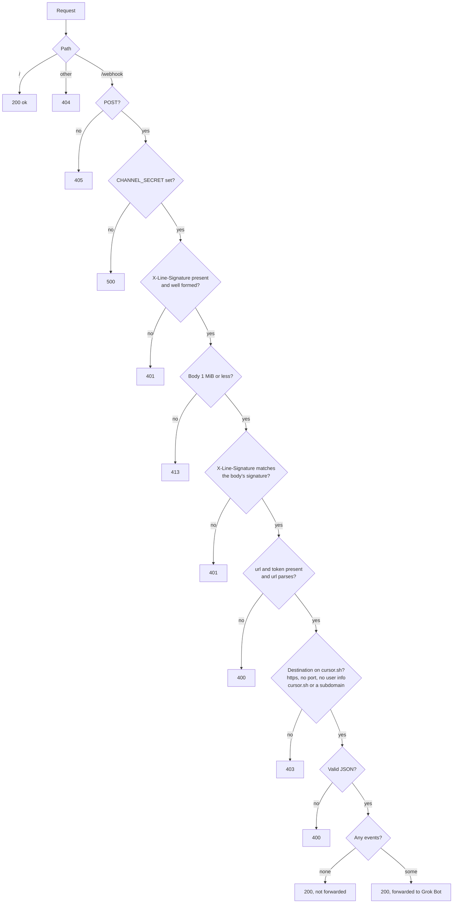

# grok-bot-line-relay

English | [日本語](README.md)

A Cloudflare Workers template that delivers webhooks from a LINE Official Account to a Grok Bot webhook.
LINE webhooks cannot carry a custom key header, so this Worker sits in between and moves the key into one.
It runs on your own Cloudflare account (the free plan is enough). Nothing passes through the author's servers.

- It stores nothing. It passes the request body to Grok Bot as received.
- It cannot send messages to LINE and holds no channel access token.
- It verifies the LINE signature and forwards only what really comes from LINE.
- The only value to set is `CHANNEL_SECRET`, your LINE channel secret.

## What you need

- A LINE Official Account with the Messaging API enabled ([LINE Developers Console](https://developers.line.biz/console/))
- Your Grok Bot webhook URL and token
- Your LINE channel secret (open the channel in the LINE Developers Console; it is on the "Basic settings" tab)
- A Cloudflare account (the free plan is enough)
- A GitHub account (you fork this repository into your GitHub)

## Setting up

Fork this repository and connect it to Cloudflare. With a fork, you pick up updates later just by pressing "Sync fork".

1. [Fork this repository](https://github.com/keesmark/grok-bot-line-relay/fork). On the page that opens, press "Create fork".
2. In the Cloudflare dashboard, open "Workers & Pages", choose "Create" and then "Import a repository". Connect GitHub and pick the fork from step 1. If the fork is not listed, give the Cloudflare app access to it in your GitHub settings.
3. Keep the Worker name `grok-bot-line-relay` and deploy. If it differs from `name` in `wrangler.jsonc`, the build fails. If you already have a Worker with that name from the old Deploy button, do not set it up again; use "Switch to a fork" under [If you used the Deploy button](#if-you-used-the-deploy-button) instead.
4. Once deployed, open the Worker's Settings → Variables and Secrets, add `CHANNEL_SECRET` as a secret, and enter your LINE channel secret. Until then the Worker returns 500 and forwards nothing.

Screen labels may change. If you cannot find one, look for the closest match.

- Do not edit files in your fork. Edits can conflict when you pick up updates.
- A fork of a public repository stays public and cannot be made private. The channel secret and token never go into the repository; they live only in your Cloudflare and LINE settings, so a public fork is fine.

## Connecting LINE

Once the Worker is up, paste the following into the Webhook URL field in the LINE Developers Console, press "Verify" and check that it succeeds.

```
https://<your Worker URL>/webhook?url=<Grok Bot webhook URL>&token=<Grok Bot token>
```

URL-encode `url`. The Worker sends `token` as `Authorization: Bearer <Grok Bot token>` and posts the body to `url` exactly as LINE sent it.

- A Grok Bot webhook URL looks like `https://api2.cursor.sh/automations/webhook/…`.
- Only https URLs on `cursor.sh` and its subdomains are allowed as destinations (`GROK_BOT_DOMAINS` in `src/env.ts`). The path is not checked, so the Worker keeps working if the shape of Grok Bot URLs changes. Any other destination gets a 403 and nothing is forwarded.
- The token is part of the URL, so request logs are turned off. Do not paste this URL into chats or other places.
- Requests with no events, such as the "Verify" button, are not forwarded.
- The Worker returns 200 to LINE even when the destination returns an error. LINE does not retry, so check that message in the LINE chat.

### About the LINE signature

LINE signs the body with your channel secret and sends the result in the `X-Line-Signature` header. The Worker computes the signature over the body exactly as received; requests whose signature does not match get a 401 and nothing is forwarded. A missing or malformed signature gets a 401 before the body is read. If `CHANNEL_SECRET` is not set, the Worker returns 500 and forwards nothing.

So only bodies signed by LINE are forwarded, and anyone who learns your Worker URL cannot attach a body of their own and their own `token` to make your Worker POST to `cursor.sh` (using it as a relay). The signature and body also reach Grok Bot, so whoever obtains them can send that same body to the Worker again, but they can only repeat a body LINE already sent. The `X-Line-Signature` header is also passed through to Grok Bot unchanged.

If you reissue the channel secret in the LINE Developers Console, update `CHANNEL_SECRET` too, with the command below or in the Cloudflare dashboard under the Worker's Settings → Variables and Secrets. Until you do, every request from LINE gets a 401.

```sh
npx wrangler secret put CHANNEL_SECRET
```

## Updating

Changes to the template are listed in the [commit history](https://github.com/keesmark/grok-bot-line-relay/commits/main). Updating keeps your Worker URL and `CHANNEL_SECRET`, so the LINE settings stay as they are. If you were using the `RELAY_KEY` passphrase, read [Moving from RELAY_KEY](#moving-from-relay_key) first.

After updating, check in Cloudflare that the new deployment succeeded, and send one message from LINE to check that it reaches Grok Bot. If something breaks, you can roll the Worker back to the previous version in the Cloudflare dashboard. The repository still holds the new version, so it is deployed again the next time you update. Wait for a fixed update before updating again.

### If you set up from a fork

On your fork's page, press "Sync fork" → "Update branch". Read through the listed commits before pressing it. Cloudflare deploys the update automatically.

If GitHub reports a conflict, it is because files in your fork were edited. [Replacing with git](#replacing-with-git) brings it back.

### If you used the Deploy button

Earlier versions had a Deploy button. The repository it created is a copy that is not linked to this one, so pick up updates in one of these two ways.

**1. Switch to a fork (recommended)**

After switching once, you can use "Sync fork" just like a fork. This only works if your Worker is named `grok-bot-line-relay`.

1. [Fork this repository](https://github.com/keesmark/grok-bot-line-relay/fork). Your copy already uses the same name, so give the fork a different one.
2. In Cloudflare, open the Worker's Settings → Builds, disconnect the current repository and connect the fork from step 1. If the fork is not listed, give the Cloudflare app access to it in your GitHub settings.
3. Check that the new deployment succeeded.

**2. Replace with git**

Follow [Replacing with git](#replacing-with-git) below.

### Replacing with git

This replaces main in your repository with the latest template commit. It works for a fork and for a copy made with the Deploy button. Anything you changed in your repository is lost.

Without git on your machine, open your repository's page, create a Codespace from "Code" → "Codespaces", and run the commands from the third line in its terminal.

```sh
git clone https://github.com/<your GitHub name>/<your repository>.git
cd <your repository>
git fetch https://github.com/keesmark/grok-bot-line-relay.git main
git reset --hard FETCH_HEAD
git push --force origin main
```

If your Worker is not named `grok-bot-line-relay`, change `name` in `wrangler.jsonc` to your Worker's name and commit before `git push`. Otherwise the build fails.

### Moving from RELAY_KEY

Earlier versions checked a `RELAY_KEY` passphrase and `key=` in the URL instead of the LINE signature. The current version does not use `RELAY_KEY` and returns 500 without `CHANNEL_SECRET`. To avoid losing messages, go in this order.

1. Before updating, open the Worker's Settings → Variables and Secrets, add `CHANNEL_SECRET` as a secret, and enter your LINE channel secret.
2. Update as described in [Updating](#updating), and check that the deployment succeeded.
3. In the LINE Developers Console, remove `&key=<passphrase>` from the Webhook URL, save, press "Verify" and check that it succeeds. The Worker still works with `key=` left in, but there is no reason to keep an unused passphrase in the URL.
4. Delete `RELAY_KEY` from the Worker's Variables and Secrets.

## Design

### Overall flow



The Worker returns 200 to LINE first and forwards to Grok Bot in the background (`ctx.waitUntil`). It stores nothing.

### Request handling



### Files

| File | Role |
| --- | --- |
| `src/index.ts` | Routes requests by path |
| `src/webhook.ts` | Handles `/webhook` and forwards to Grok Bot |
| `src/env.ts` | Allowed destinations, and building the destination from `url` and `token` |
| `src/signature.ts` | Checks the LINE signature |
| `src/body.ts` | Reads the body with a size cap |

## Security

- No runtime dependencies. Development tools are pinned to exact versions with a lockfile.
- Versions published less than 7 days ago are not installed (`min-release-age=7` in `.npmrc`, honored by npm 11.10 and later), since hijacked releases are usually found and pulled within days. Every version in the lockfile is at least 7 days old.
- The request body is capped at 1 MiB, and reading stops once the cap is exceeded.
- Redirects from the destination are never followed. The destination check only covers the first URL, so following one could deliver the body and token outside `cursor.sh`.
- Forwarding gives up after 10 seconds.
- Logs never include the body, the URL, or the key.
- If you find a vulnerability, please report it privately as described in [SECURITY.md](SECURITY.md).

## Development

```sh
npm ci
cp .dev.vars.example .dev.vars  # set CHANNEL_SECRET= to your channel secret
npm test
npm run coverage
npm run dev
```

## License

[MIT](LICENSE)
