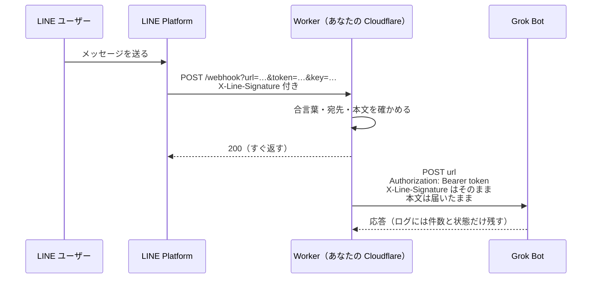
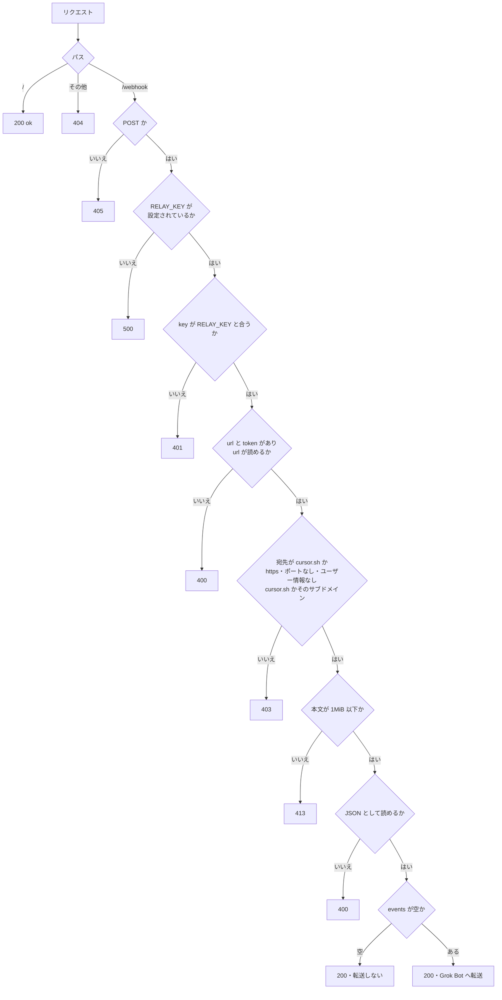

# grok-bot-line-relay

[English](README.en.md) | 日本語

LINE 公式アカウントの Webhook を、Grok Bot の Webhook に届けるための Cloudflare Workers のテンプレートです。
LINE の Webhook は送信キーのヘッダーを付けられないので、この Worker が間に立ってキーを付け替えます。
あなた自身の Cloudflare アカウント（無料プラン）で動きます。作者のサーバーは一切通りません。

- 何も保存しません。届いた本文を、そのまま Grok Bot に流すだけです。
- LINE へ送信する機能はありません。チャネルアクセストークンも持ちません。
- 設定する値は、この Worker 専用の合言葉 `RELAY_KEY` の1つだけです。

## 準備するもの

- Messaging API が使える LINE 公式アカウント（[LINE Developers コンソール](https://developers.line.biz/console/)）
- Grok Bot の Webhook の URL と送信キー
- 合言葉にする長いランダムな文字列（例: `openssl rand -hex 32` の出力）
- Cloudflare のアカウント（無料プランで動きます）
- GitHub のアカウント（このリポジトリを、あなたの GitHub にフォークまたは複製します）

## 作り方

作り方は2つあります。あとから更新を取り込みやすいのは A です。迷ったら A にしてください。

| | A. フォークで作る（おすすめ） | B. Deploy ボタンで作る |
| --- | --- | --- |
| 作る手間 | 手順が4つ | ボタン1つ |
| 更新の取り込み | 「Sync fork」を押すだけ | 手作業（[アップデートのしかた](#アップデートのしかた)） |

### A. フォークで作る（おすすめ）

1. GitHub でこのリポジトリを開き、右上の「Fork」を押します。
2. Cloudflare のダッシュボードで「Workers & Pages」を開き、「作成」（Create）から「リポジトリをインポート」（Import a repository）を選びます。GitHub をつなぎ、1 で作ったフォークを選びます。フォークが一覧に出ないときは、GitHub の画面で Cloudflare のアプリにそのリポジトリへのアクセスを許可します。
3. Worker の名前は `grok-bot-line-relay` のままでデプロイします。`wrangler.jsonc` の `name` と違うと、ビルドが失敗します。B で作った同じ名前の Worker がすでにあるときは、A で作り直さずに [アップデートのしかた](#アップデートのしかた) の B の「フォークに付け替える」を使ってください。
4. デプロイできたら、Worker の「設定」→「変数とシークレット」で `RELAY_KEY` を「シークレット」として追加し、合言葉を入れます。入れるまでは、Worker は 500 を返して何も転送しません。

画面の名前は変わることがあります。見つからないときは、近い名前のものを探してください。

- フォークしたリポジトリのファイルは編集しないでください。編集すると、更新を取り込むときに衝突することがあります。
- 公開リポジトリのフォークは公開のままで、非公開にはできません。合言葉や送信キーはリポジトリには入らず、Cloudflare と LINE の設定にだけ置くので、公開でも困りません。

### B. Deploy ボタンで作る

[](https://deploy.workers.cloudflare.com/?url=https://github.com/keesmark/grok-bot-line-relay)

ボタンを押すと、このリポジトリがあなたの GitHub に複製されます（フォークではありません）。デプロイ画面で `RELAY_KEY` に合言葉を入れてデプロイします。手早く作れますが、元のリポジトリとはつながっていないので、更新の取り込みは手作業になります。

## つなぎ方

Worker ができたら、LINE Developers コンソールの Webhook URL に次を貼り、「検証」を押して成功を確かめます。

```
https://<Worker の URL>/webhook?url=<Grok Bot の Webhook の URL>&token=<送信キー>&key=<合言葉>
```

`url` は URL エンコードしてください。Worker は `token` を `Authorization: Bearer <送信キー>` に付け替えて、本文を LINE から届いたまま `url` に流します。

- Grok Bot の Webhook の URL は `https://api2.cursor.sh/automations/webhook/…` の形です。
- 流せる宛先は、`cursor.sh` とそのサブドメインの https の URL だけです（`src/env.ts` の `GROK_BOT_DOMAINS`）。パスは問わないので、Grok Bot の URL の形が変わっても動き続けます。ほかの宛先を指定すると 403 になり、どこにも流しません。
- 送信キーと合言葉が URL に入るので、リクエストのログは残しません。この URL はチャットなどに貼らないでください。
- 「検証」ボタンのようにイベントが空のものは流しません。
- 流した先がエラーを返しても、LINE には 200 を返します。LINE は再送しないので、そのメッセージは LINE のチャットで確かめてください。

### LINE の署名について

この Worker は LINE の署名を確かめません。偽のメッセージを Grok Bot に届けるには送信キー（`token`）が要りますが、送信キーを知っている人は Worker を通さずに Grok Bot へ直接送れるので、Worker で確かめても守りが増えないためです。LINE の `X-Line-Signature` ヘッダーはそのまま Grok Bot に渡すので、必要なら Grok Bot 側で確かめられます。

### 合言葉（RELAY_KEY）について

合言葉がないと、Worker の URL を知った人が、自分の `token` と本文を付けて、あなたの Worker から `cursor.sh` に POST させられます（踏み台）。これを防ぐため、`key` が `RELAY_KEY` と合わないリクエストは 401 にして、どこにも流しません。`RELAY_KEY` が設定されていないときは 500 を返し、何も流しません。

合言葉をあとから変えるときは、次のコマンドか、Cloudflare のダッシュボードで Worker の「設定」→「変数とシークレット」から変え、LINE に登録した URL の `key=` も合わせて変えます。

```sh
npx wrangler secret put RELAY_KEY
```

## アップデートのしかた

テンプレートの変更は [コミットの一覧](https://github.com/keesmark/grok-bot-line-relay/commits/main) で見られます。どの方法でも Worker の URL と `RELAY_KEY` は変わらないので、LINE の設定はそのまま使えます。

取り込んだら、Cloudflare で Worker の新しいデプロイが成功したことと、LINE から1通送って Grok Bot に届くことを確かめてください。うまく動かないときは、Cloudflare のダッシュボードで Worker を前の版に戻せます。戻してもリポジトリの中身は新しいままなので、次に取り込んだときにまたデプロイされます。直った更新が出てから取り込んでください。

### A（フォーク）で作った場合

フォークのページで「Sync fork」→「Update branch」を押します。押す前に、取り込まれるコミットの一覧に目を通してください。取り込むと、Cloudflare が自動でデプロイします。

衝突すると言われたときは、フォークのファイルを編集していたためです。[git で置き換える](#git-で置き換える) の手順で元に戻せます。

### B（Deploy ボタン）で作った場合

方法は2つあります。

**1. フォークに付け替える（おすすめ）**

一度付け替えれば、次からは A と同じく「Sync fork」で取り込めます。Worker の名前が `grok-bot-line-relay` のときだけ使えます。

1. GitHub でこのリポジトリをフォークします。複製のリポジトリと同じ名前は使えないので、フォークには別の名前を付けます。
2. Cloudflare で Worker の「設定」→「ビルド」を開き、いまつないでいるリポジトリを外して、1 のフォークをつなぎます。フォークが一覧に出ないときは、GitHub の画面で Cloudflare のアプリにそのリポジトリへのアクセスを許可します。
3. Worker の新しいデプロイが成功したことを確かめます。

**2. git で置き換える**

下の [git で置き換える](#git-で置き換える) の手順を使います。

### git で置き換える

あなたのリポジトリの main を、テンプレートの最新のコミットに丸ごと置き換えます。A でも B でも使えます。自分のリポジトリで変えたところは、すべて消えます。

手元に git がなければ、自分のリポジトリのページで「Code」→「Codespaces」から Codespace を作り、そのターミナルで3行目から打ちます。

```sh
git clone https://github.com/<あなたの GitHub 名>/<あなたのリポジトリ名>.git
cd <あなたのリポジトリ名>
git fetch https://github.com/keesmark/grok-bot-line-relay.git main
git reset --hard FETCH_HEAD
git push --force origin main
```

Worker の名前を `grok-bot-line-relay` から変えていた場合は、`git push` の前に `wrangler.jsonc` の `name` を自分の Worker の名前に直してコミットしてください。直さないとビルドが失敗します。

## 設計

### 全体の流れ



LINE には先に 200 を返し、Grok Bot への転送はその後ろで行います（`ctx.waitUntil`）。Worker は何も保存しません。

### リクエストの判定



### ファイル

| ファイル | 役目 |
| --- | --- |
| `src/index.ts` | パスごとの振り分け |
| `src/webhook.ts` | `/webhook` の処理と Grok Bot への転送 |
| `src/env.ts` | 転送してよい宛先の一覧と、`url`・`token` からの宛先づくり |
| `src/key.ts` | `RELAY_KEY` と `key` の照合 |
| `src/body.ts` | 本文を上限つきで読む |

## セキュリティ

- 実行時の依存はありません。開発用の道具は版を固定し、ロックファイルを入れています。
- 公開から7日たっていない版は入れません（`.npmrc` の `min-release-age=7`。npm 11.10 以降で効きます）。乗っ取られた版がすぐ見つかって消されることが多いためです。ロックファイルの版も、すべて公開から7日以上たったものです。
- 本文の大きさに上限（1MiB）をかけ、上限を超えたら読むのをやめます。
- 転送先がリダイレクトを返しても追いかけません。宛先の確認は最初の URL にしか効かないので、追いかけると `cursor.sh` の外に本文や送信キーが届くおそれがあるためです。
- 転送は10秒で打ち切ります。
- ログには本文・URL・鍵を出しません。
- 脆弱性を見つけたときは [SECURITY.md](SECURITY.md) の手順で、非公開で知らせてください。

## 開発

```sh
npm ci
cp .dev.vars.example .dev.vars  # RELAY_KEY= に好きな値を入れる
npm test
npm run coverage
npm run dev
```

## ライセンス

[MIT](LICENSE)

---

LINE は LINE ヤフー株式会社の商標です。本リポジトリは LINE ヤフー株式会社の公式製品ではありません。
